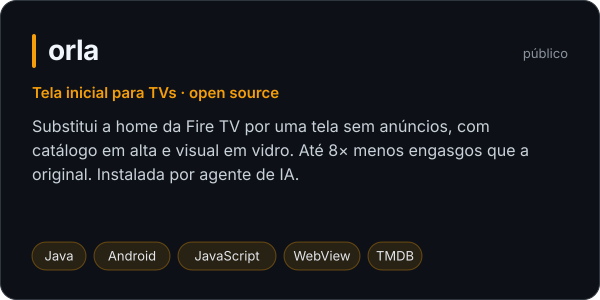
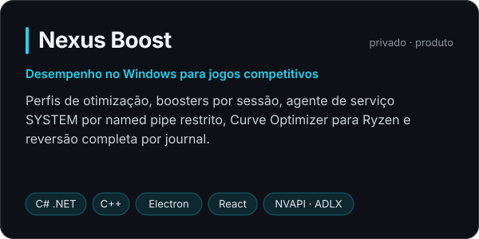
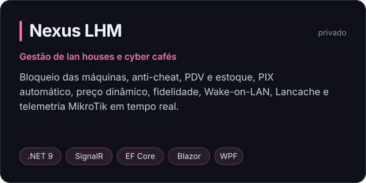
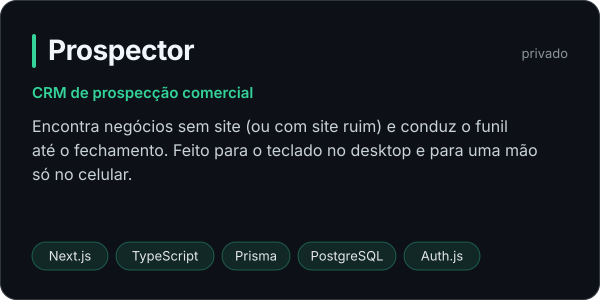
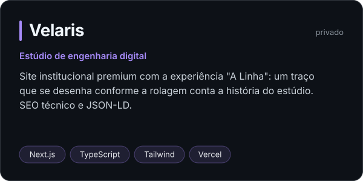

**Analista de Desenvolvimento de Software na Pantanal Agrícola · Formado em Engenharia da Computação · Brasil**

## Sobre mim

Engenheiro da Computação e Analista de Desenvolvimento de Software no agronegócio. Escrevo os
sistemas que a empresa usa no dia a dia, integrados ao SAP Business One, e trabalho os dados 
por trás deles com Python e SQL. Antes do desenvolvimento, passei pela infraestrutura: 
rede e servidores, e esse lado continua presente no que construo.

Hoje levo projetos de ponta a ponta, do código que fala com o hardware até o site que vende:

- **Sistemas e desempenho.** Serviços Windows em C#/.NET.
- **Produto completo.** Contas, licenças, pagamentos (Stripe, PIX), painel administrativo e
  auditoria, não só a tela bonita.
- **Interfaces que rodam em qualquer aparelho.** Da tela inicial da TV, medida quadro a quadro
  num Fire TV Stick, a sites com animação guiada pela rolagem.
- **Infra de verdade.** Redes, MikroTik, Wake-on-LAN, cache local de jogos: o que aprendi no
  trabalho virou funcionalidade nos meus projetos.

Gosto de problema concreto, número medido e código que outra pessoa consegue manter.

## Projetos

  
  

  
  

  

Os projetos marcados como privados têm código fechado. Sites: [nexusboost.app](https://nexusboost.app)
· [velarisdev.com.br](https://velarisdev.com.br).

## Ferramentas

  
  
  
  
  
  
  
  
  
  
  

